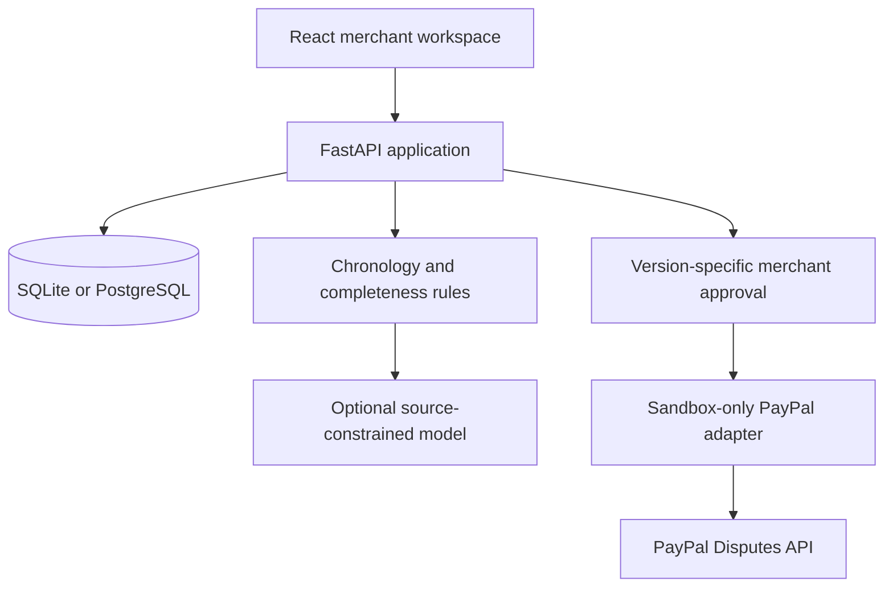

# CaseWeave

**Evidence, connected.** A merchant workspace for preparing traceable responses to PayPal disputes, starting with cancellation-related recurring billing.

CaseWeave organizes records into a timeline, identifies missing and conflicting evidence, prepares a reviewable response, and records an explicit approval before submission. PayPal or the financial institution remains responsible for adjudication.

> **Current status:** runnable application with synthetic sample workflows, optional AI drafting, and a sandbox-only PayPal adapter. The adapter is tested with mocked HTTP responses; actual PayPal access and model inference must be configured and verified before submission to the hackathon. No hosted deployment or live integration is claimed in this repository.

## Try it locally

Requires Python 3.12+, Node.js 22+, and npm. No credentials are needed for sample workflows.

```bash
python -m venv .venv
source .venv/bin/activate
pip install -r backend/requirements-dev.txt
npm ci --prefix frontend
npm run build --prefix frontend
cp .env.example .env
PYTHONPATH=backend uvicorn caseweave.main:app --env-file .env --reload
```

Open **http://localhost:8000**. On Windows PowerShell, activate with `.venv\Scripts\Activate.ps1`, set `$env:PYTHONPATH="backend"`, and run `uvicorn caseweave.main:app --env-file .env --reload`.

For frontend hot reload, run `npm run dev --prefix frontend` in another terminal and visit the printed Vite address; `/api` proxies to port 8000.

Or use Docker:

```bash
docker build -t caseweave .
docker run --rm -p 8000:8000 --env-file .env caseweave
```

## Judge walkthrough

1. Open the app. It creates an isolated seven-day browser session with three **synthetic** cases.
2. Select **Renewal after confirmed cancellation**. Inspect the timeline and click a source label to read its record.
3. Select **Run evidence checks**. If a model is configured, the button instead offers **Analyze with AI**.
4. Inspect findings, missing evidence, and the editable response. Coverage measures record types present, not confidence or case strength.
5. Review and approve the exact version; then select **Complete sample workflow**. The audit trail explicitly records a simulation, with no PayPal API call.
6. Try **Cancellation claimed, confirmation missing**. Add a cancellation record through the Evidence tab (paste text or import a `.txt` file), rerun checks, and observe the changed findings.
7. Export a JSON evidence package. Reset the sample cases with the inbox reset button.

Sample actions are never presented as actual PayPal submissions. Credentials configured on the server do not convert fixtures into real disputes.

## Configuration

Set these in a local ignored `.env` file or your deployment's secret settings. Never place secrets in source code or frontend build variables.

| Variable | Purpose |
| --- | --- |
| `DATABASE_URL` | Defaults to SQLite for local/sample use. Supports `postgresql://` and Render's `postgres://` URLs via psycopg. |
| `ADMIN_TOKEN` | Strong random bearer token guarding sandbox import and submission. No default access is enabled. |
| `PAYPAL_CLIENT_ID`, `PAYPAL_CLIENT_SECRET` | Merchant app's **sandbox** credentials. |
| `AI_BASE_URL` | Trusted provider's OpenAI-compatible API base, including `/v1` where required. |
| `AI_API_KEY`, `AI_MODEL` | Enable actual model drafting. Model must support `response_format: json_object`. |
| `COOKIE_SECURE` | Set `true` on HTTPS deployments; `false` only for local HTTP development. |
| `MAX_SESSIONS` | Caps stored active visitor sessions; default 1000. |

Without a model, the app identifies itself as **Evidence checks** and produces a deterministic draft. A failed or invalid model response falls back to those checks with a visible notice. No canned answer is labelled AI-generated. Citation validation checks source IDs, not whether each statement is semantically supported; human review remains necessary.

Generate an admin token:

```bash
python -c "import secrets; print(secrets.token_urlsafe(32))"
```

The Connections dialog accepts this operator token in page memory only. It never asks for the PayPal client secret. Do not distribute the operator token to public demo visitors.

## PayPal integration

All calls are fixed to `https://api-m.sandbox.paypal.com`. There is no live-payment mode.

1. Configure the merchant app and enable Disputes in its features.
2. Set server-side sandbox credentials and `ADMIN_TOKEN`.
3. Obtain an actual dispute belonging to that merchant/app. Creating disputes via the sandbox creation API needs additional buyer-side permissions and an enabled `DISPUTE_CREATE` scope; simply creating an app does **not** establish that access. Use PayPal's documented sandbox setup or ask the hackathon PayPal team for an eligible test case.
4. In Connections, enter the operator token and `PP-…` dispute ID, then import it.
5. Import retrieves dispute facts only. It does not invent a payment, cancellation confirmation, subscription agreement, or delivery record. Add those separately as merchant-supplied text; they are marked unverified.
6. Analyze, edit, review, and approve the exact draft version.
7. Submit the approved note to the sandbox. CaseWeave refreshes dispute details and checks `WAITING_FOR_SELLER_RESPONSE`, the available `provide_evidence` action, and the requested evidence types. The first version supports **OTHER note evidence only**; it does not attach original files or send tracking/refund-specific evidence.

API operations:

- `POST /v1/oauth2/token`
- `GET /v1/customer/disputes/{id}`
- `POST /v1/customer/disputes/{id}/provide-evidence` using multipart `input`

A successful submission means the API accepted evidence, **not** that the merchant won. Uncertain network results are locked against automatic retries and require checking the case in PayPal. The prototype permits one sandbox submission attempt per dispute ID across all sessions, including reimports. A failed or uncertain attempt requires operator investigation rather than an automatic retry.

References: [PayPal Disputes integration](https://developer.paypal.com/platforms/disputes/integrate-disputes/) · [Sandbox guide](https://developer.paypal.com/sandbox-testing/overview/).

## Deploy on Render

This repository contains a Dockerfile and a `render.yaml` Blueprint. See [docs/DEPLOYMENT.md](docs/DEPLOYMENT.md) for the full path and secret configuration.

[](https://render.com/deploy?repo=https://github.com/abdel-saw/caseweave)

The Blueprint requests a free web service, uses ephemeral SQLite, and does not provision a paid database. SQLite data may disappear on a restart/redeploy; this is acceptable for disposable sample sessions, not persistent merchant cases. Configure persistent PostgreSQL before storing cases that must survive restarts. Confirm platform terms, capacity, and pricing in Render before deployment. Free-service cold starts and resource limits can affect judge access.

Hackathon sponsor resource: [Render $50 credit claim portal](https://credits-portal-mmdm.onrender.com/claim/paypal-ai-hackathon), linked from the [official sponsor page](https://paypalaihackathon.devpost.com/details/render). Redemption is account-dependent and not required to develop locally.

## Architecture



- React/Vite UI, Lucide icons, custom responsive CSS; no external fonts or visual assets.
- FastAPI/Pydantic request validation; SQLAlchemy persistence.
- Secure visitor cookie, scoped case reads/writes/exports, seven-day expiry and lazy cleanup.
- Optimistic concurrency checks prevent an old analysis or edit from overwriting a newer case version.
- AI model receives case evidence and rule findings with no action tools. Uploaded source instructions have no authority.
- Approval binds an evidence/draft digest. Edits invalidate approval.
- Persisted submission state and a preflight case refresh protect against repeated or stale submissions.
- Render Docker deployment serves the frontend and API from one origin.

## Tests

```bash
python -m pytest -q
npm run build --prefix frontend
```

GitHub Actions runs both checks. Tests cover cross-session access, chronology, missing evidence, invalid timestamps, stale approvals, sample/sandbox separation, duplicate submission, uncertain responses, requested evidence guards, secrets exposure, model source validation, fallback behavior, and HTTP multipart construction. These are local/mocked tests, not proof of connectivity to PayPal or an inference provider.

## Scope and limitations

- First workflow: cancellation-related recurring billing. Other dispute reasons need specialist evidence checks.
- No dispute adjudication, fraud verdicts, fund release, KYC decisions, automatic refunds, or subscription cancellation.
- No claim that an invoice, delivery record, or customer assertion proves authorization.
- Text ingestion only, up to 6000 characters per source; no OCR or PDF parser.
- No webhooks, scheduled synchronization, carrier connector, or automatic subscription-history retrieval in this version.
- Single operator sandbox integration; no production merchant OAuth onboarding.
- Visitor sessions isolate demo data but do not replace production identity/access management. Do not upload real personal or financial data to a public demo.
- The model receives submitted source text at the configured provider; use synthetic/redacted content for judging.
- No production-scale abuse controls, immutable audit storage, migrations, or broad document authenticity verification. Current AI throttle is per case; public exposure should also use hosting-level rate limits and provider spending caps.

## Submission materials

- [Project description and tools disclosure](docs/SUBMISSION.md)
- [Demo script under three minutes](docs/DEMO_SCRIPT.md)
- [Evaluation plan and outstanding validation](docs/EVALUATION.md)
- [Deployment and integration setup](docs/DEPLOYMENT.md)

## License

MIT. See [LICENSE](LICENSE). Original interface and sample records; Lucide icons are ISC-licensed through the dependency. CaseWeave is an independent hackathon prototype, not an official PayPal product.
