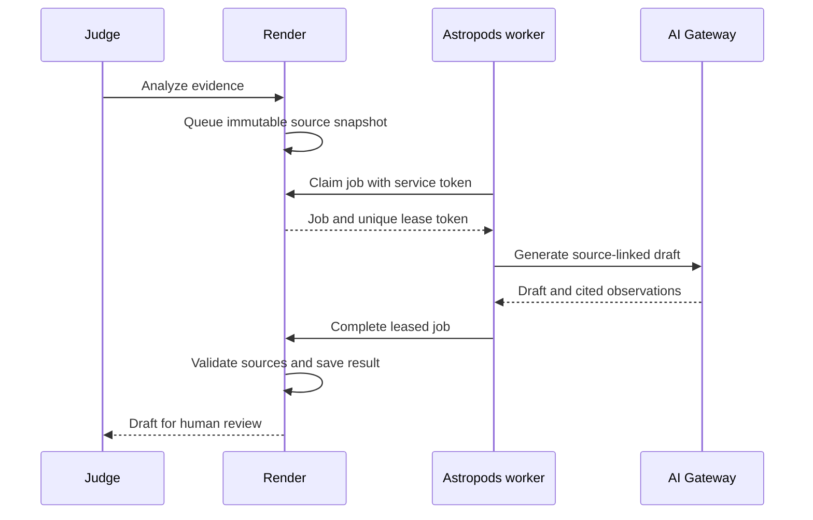
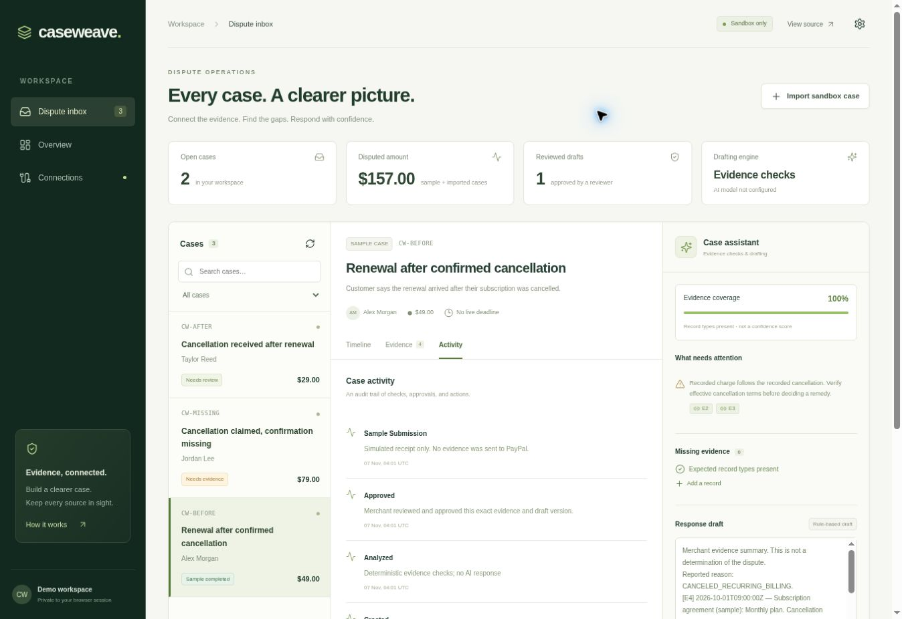

# Deploy the CaseWeave Astropods drafting worker

The judge-facing application stays at **https://caseweave.onrender.com/**. The worker runs inside Astropods and uses its injected AI Gateway credentials. It makes outbound authenticated requests to Render; Render never needs to enter an Astropods sign-in page or call the worker's hostname.



## 1. Prerequisites on your machine

- Docker installed **and running**.
- Astropods CLI installed: [official installation instructions](https://docs.astropods.com/install-cli).
- Your Astropods account, with gateway credits available.
- The latest repository checkout:

```bash
git clone https://github.com/abdel-saw/caseweave.git
cd caseweave
```

For an existing checkout, run `git pull --ff-only` instead. Do not run `ast project create` inside this repository: the worker, Dockerfile, and spec are already implemented.

## 2. Create one private service token

Generate a random value locally:

```bash
python -c "import secrets; print(secrets.token_urlsafe(32))"
```

Keep it private. Store the **same value** in Render and the Astropods secret vault. It authorizes the worker's queue access; it is not a PayPal key, gateway key, CLI token, or deployment token.

## 3. Configure Render

In the CaseWeave service's Environment settings, add these together and redeploy:

```text
AI_TRANSPORT=astropods_queue
DRAFTER_SHARED_TOKEN=<the private random value>
DRAFTER_WAIT_SECONDS=55
```

Preserve existing PayPal credentials and `ADMIN_TOKEN`. No model key or `AI_MODEL` is required on Render for this transport. Gateway credentials remain inside Astropods. The UI will say **AI configured**, which means configuration is present, not that a worker has authenticated or inference has succeeded.

Until the worker is running, an analysis request waits up to 55 seconds, then visibly falls back to evidence checks. Do not repeatedly click analysis during deployment.

## 4. Authenticate and publish the worker

From the repository root:

```bash
ast login
ast secrets create DRAFTER_SHARED_TOKEN
ast blueprint push
```

`ast secrets create` prompts for the token and masks the input. Paste the same value stored in Render. If that vault secret already exists, update it through the Astropods console rather than creating a different value.

`ast blueprint push` builds `Dockerfile.drafter` using `astropods.yml`, and pushes the `caseweave-drafter` blueprint. These files do not change the main Render Docker build. Run from a clean, committed checkout; the CLI checks build provenance.

## 5. Deploy

```bash
ast blueprint deploy caseweave-drafter --var DRAFTER_SHARED_TOKEN=@ --wait
```

The `@` reference reads the secret from the vault instead of putting it into the command line. The spec defaults `CASEWEAVE_URL` to `https://caseweave.onrender.com`. Choose **claude-haiku-4-5** initially if prompted; the spec also lists Sonnet as an alternative.

The deployment injects `ASTRO_GATEWAY_URL`, `ASTRO_GATEWAY_API_KEY`, and `MODEL_DEFAULT`. The worker adds `/v1` once and uses prompt-based JSON. Do not copy gateway credentials, `ASTRO_AUTHZ_TOKEN`, or browser cookies into Render.

Keep Astropods' normal sign-in/access settings. No Public routing, anonymous access grant, cookie forwarding, or inbound inference API is needed. The worker's HTTP surface serves `/health` and a minimal status page on port 80; it exposes no model-generation route. The Launch button opens status, not a chat. Use CaseWeave on Render to request an analysis. Health reports configuration presence, not a successful gateway call.

## 6. Verify real inference

1. In Render, confirm the latest commit deployed successfully.
2. Start with fresh sample cases. Resetting samples removes their old queued jobs/results; imported sandbox cases are preserved.
3. Click **Analyze with AI** once on a sample case.
4. Confirm the completed response says **AI draft**, displays the actual gateway model name, and links to valid source records.
5. Inspect Astropods usage/traces to confirm the request consumed gateway inference.
6. Try the missing-confirmation case. Review all generated statements; valid citation IDs alone do not establish factual faithfulness.
7. If the app shows **Rule-based draft**, actual inference did not complete. It is not an AI success. Check worker logs, gateway credits, shared-token equality, and Render availability.

## Protocol and behavior

The Render server exposes two internal worker operations. Both require `Authorization: Bearer <DRAFTER_SHARED_TOKEN>`, independently of visitor cookies and the PayPal operator token.

- `POST /api/internal/drafting/claim` returns one immutable job and its unique lease token, or `{"job": null}`.
- `POST /api/internal/drafting/jobs/{id}/complete` accepts the lease token plus either a validated draft/model result or a bounded error code.

Workers never receive PayPal credentials, the operator token, or visitor cookies. They receive the case reason/amount/currency and source evidence needed to draft. Use synthetic/redacted evidence in the public demo; source text is sent to the configured gateway.

A job is atomically leased to one worker and **never automatically reassigned** after a worker crash. Posting the same completed result again is idempotent, so a lost acknowledgment does not trigger another inference. Changed source snapshots invalidate pending jobs. Results are bound to the original sources and are revalidated on Render. Human approval still occurs in the main app after generation.

Identical case inputs reuse their completed result to avoid repeat inference. Failed/expired jobs are not automatically retried. For synthetic testing after fixing configuration or changing models, reset sample cases. This deletes only sample cases, edits, and their jobs, so export any test work you want to retain first.

## Limits and persistence

- Default polling interval: 5 seconds (configurable with `DRAFTER_POLL_SECONDS`).
- At most 6 inference attempts per minute and 100 per worker process by default.
- At most 30,000 source-text characters per job and 1,800 requested completion tokens by default.
- `DRAFTER_MAX_CALLS`, `DRAFTER_REQUESTS_PER_MINUTE`, and `AI_MAX_TOKENS` are declared deploy-time inputs.
- Per-process counters reset when the worker restarts. They are **not a dollar spending cap**; set account usage limits in Astropods and watch the $10 balance.
- The model has no tools or payment access. Invalid JSON/citations cause an error and an honest rule-based fallback.
- Default Render SQLite is ephemeral. A Render restart may erase cases/jobs; durable merchant operation requires PostgreSQL. Single-lease protections apply within the lifetime of the retained database, not across database loss.
- If a job expires while inference is already in flight, the worker may still incur that one call's charge; its late result is rejected. There is no automatic second inference.

## Verified and unverified

Local tests exercise the actual Render API → job lease → worker → completion → application analysis path, with only model HTTP mocked. They cover worker authentication, concurrent claims, stale/expired jobs, repeated acknowledgments, failure fallback, validation, and secret separation.

Docker and `ast` are unavailable in the development executor, and there is no authenticated Astropods account session here. Image build, spec validation by the CLI, real gateway inference, and live worker deployment therefore remain to be verified on your machine/account. No credits were consumed by the local tests.

The hosted sample review/approval/simulated-submission workflow was browser-verified on November 7, 2026. PayPal credentials were reported present, but actual PayPal authentication and dispute submission remain unverified.



## References

- [Astropods quick start](https://docs.astropods.com/get-started)
- [Custom HTTP agent and port 80](https://docs.astropods.com/frontend-agents)
- [Gateway injection](https://docs.astropods.com/ai-gateway)
- [Portable JSON output](https://docs.astropods.com/ai-gateway/chat)
- [Blueprint push/deploy](https://docs.astropods.com/cli/blueprint)
- [Secrets](https://docs.astropods.com/secrets)

## Troubleshooting an Active worker with rule-based drafts

An Active deployment does not establish that a gateway call succeeded. A startup-probe event can describe an earlier failure; check its last occurrence and current logs. The probe bypasses environment HTTP proxies for loopback, uses a 3-second HTTP timeout, and allows 10 seconds for the whole Python process. `/health` checks configuration presence only.

After publishing an updated blueprint, update the existing agent:

```bash
ast agent redeploy --name caseweave-drafter --var "DRAFTER_SHARED_TOKEN=@" --wait
ast agent logs --name caseweave-drafter
```

Wait for Render to deploy the same source revision before testing the worker. Reset sample cases, then analyze once. The fallback notice now distinguishes gateway authentication, rate/quota limits, rejected model requests, unavailable service, malformed output, invalid citations, and unclaimed/unfinished jobs. The API response includes a safe `fallback_reason` code. Logs include codes and HTTP status, never raw gateway responses, credentials, or evidence.

`GET /api/config` on Render includes `worker_connected_recently`: an authenticated worker poll reached this server process within 30 seconds. This process-local indicator resets on restart and is not a global health guarantee. The Astropods worker status page includes its latest stage, last error, and inference-attempt count. A failed job remains failed; reset sample cases after fixing its cause to run a new attempt.

## CPU use

The worker reuses one Render HTTP client across polls, retaining its TLS context and HTTPS connection pool. Previously it rebuilt the client every two seconds, adding avoidable CPU work even when there were no cases. Polling now defaults to five seconds, with a 30-second health-check interval. These changes reduce idle overhead; no model runs inside the worker container. They do not establish the cause of a platform CPU-limit event or guarantee a particular resource allocation. Inspect CPU metrics and the exact event if limits persist after deployment. Polling may add up to about five seconds before a new job is claimed; avoid concurrent demo analyses on a small allocation.


### Missing-evidence sample and citation failures

On November 7, a fresh hosted Jordan Lee analysis returned `invalid_citations` in about 15 seconds. Missing evidence does not disable AI drafting. This code means the returned draft or claims failed source-ID validation; it does not reveal which exact citation form the model used. The prompt now enumerates permitted IDs, requires separate bracket citations and bare IDs in `claims.sources`, and separates missing-document observations from claims about supplied records. Validation stays strict and generation is not automatically retried. Redeploy the worker, reset sample cases to remove retained failed jobs, and test once. Local mocked-gateway coverage verifies Jordan's incomplete evidence can produce an AI draft while retaining both missing-document warnings; live generation after this prompt change still needs verification.
